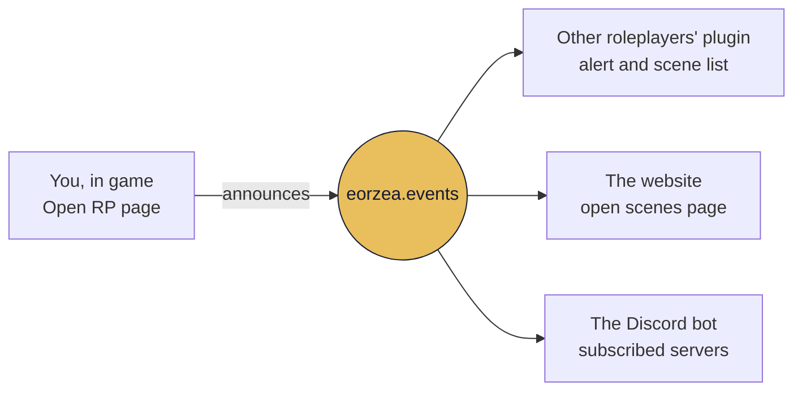

<p align="center">
  
</p>

<p align="center">
  <strong>Final Fantasy XIV roleplay, without leaving the game.</strong><br>
  Open scenes, RP profiles, the events calendar and the venue directory of
  <a href="https://eorzea.events">eorzea.events</a>, gathered in one Dalamud window.
</p>

<p align="center">
  
  
  
  <a href="https://eorzea.events"></a>
</p>

<p align="center"><a href="README.md">Français</a> · <b>English</b></p>

---

## Overview

<table>
  <tr>
    <td width="50%" valign="top">
      
      <br><sub><b>Open RP</b> · ongoing scenes, grouped by zone and world</sub>
    </td>
    <td width="50%" valign="top">
      
      <br><sub><b>Around me</b> · available roleplayers, nearest first</sub>
    </td>
  </tr>
  <tr>
    <td width="50%" valign="top">
      
      <br><sub><b>RP profile</b> · read in game, with a right click on the character</sub>
    </td>
    <td width="50%" valign="top">
      
      <br><sub><b>Nameplates</b> · RP name, RP title and "RP Avail" above heads</sub>
    </td>
  </tr>
  <tr>
    <td width="50%" valign="top">
      
      <br><sub><b>Chat</b> · RP names, emotes, out-of-character text and speech formatted</sub>
    </td>
    <td width="50%" valign="top">
      
      <br><sub><b>Events</b> · the next two weeks of events</sub>
    </td>
  </tr>
</table>

## Contents

- [Installation](#installation)
- [Getting started](#getting-started)
- [What the plugin does](#what-the-plugin-does)
- [Commands](#commands)
- [Settings](#settings)
- [Data and privacy](#data-and-privacy)
- [Help](#help)

## Installation

The plugin is distributed through a custom Dalamud repository.

1. In game, type `/xlsettings` and open the **Experimental** tab.
2. Under **Custom Plugin Repositories**, paste the following address into the empty field, click **+**, tick **Enabled**, then save:
   ```
   https://repo.eorzea.events/repo.json
   ```
   Added the old address, `https://raw.githubusercontent.com/Neprena/eorzea-events-plugin/main/repo.json`? Keep it: a plugin installed from a repository only receives updates from that repository.
3. Type `/xlplugins`, search for **Eorzea Events** and install it.

## Getting started

On first launch, the welcome screen offers two choices: **link a character** or **continue without an account**.

To link a character, log in on it, then click the link button: your browser opens a confirmation page on eorzea.events. Confirm, and the plugin retrieves its access on its own. There is no token to copy.

Each character has its own access. To link another one, log in on it and type `/eorzea link`.

> [!TIP]
> Without an account, the essentials remain available. The table below shows what a linked character adds.

| | No account | Linked character |
|---|:---:|:---:|
| Events calendar, venue directory | ✓ | ✓ |
| Ongoing open scenes | ✓ | ✓ |
| Public profiles of the roleplayers you meet | ✓ | ✓ |
| RP names and titles on nameplates, chat formatting | ✓ | ✓ |
| Encounters log | ✓ | ✓ |
| Open a scene, declare yourself available | | ✓ |
| Your RP profile, RP friends and relationships | | ✓ |

## What the plugin does

The main window sorts its pages into three groups, **Play**, **Community** and **Calendar**, with News and Settings at the bottom of the sidebar.

### Play

**Open RP.** Announce a scene without leaving the game: zone, world and position fill themselves in, you pick the duration, and "Extend (+1h)" adds an hour when the evening runs late. Ongoing scenes are grouped by zone, by world and by other servers. Each card shows the coordinates, the instance, the residential annex and how many people are on site. A scene cannot be opened at the address of a venue already registered on the website: the plugin then suggests publishing an event there instead.

A scene announced from the game shows up in three places at once:



**Around me.** Roleplayers who declared themselves available, sorted by distance: in sight, in this region, elsewhere in the world. "Filters" narrows the list down to your world, a language, a play level or an approach.

**Encounters.** A log of the characters with a visible profile you crossed paths with, with a private note for each. This log stays on your PC.

### Community

**My RP profile.** Up to three profiles per character, only one of them public, the one you choose. Long texts are written in a dedicated window with formatting buttons and a preview. The banner, portrait and accent colour set on the website are shown, along with your sync codes (Snowcloak, Umbra…), and you choose who can see them.

**Relationships.** Right-clicking a roleplayer offers "Propose a relationship": you pick the tie among nine kinds and the other person receives a request. The relationship appears on both profiles only once they accept.

**RP friends.** The characters you open the restricted sections of your profile to, added with a right click without any notification being sent. A marker shows when the friendship is mutual, and each friend can carry a private note.

### Calendar

**Events.** Events for the next fourteen days, grouped by day, with search and filters. An event's detail gives its full description, times, readable recurrence, poster, venue address, and how many people signed up and are on site. A notification can tell you when an event starts.

**Venues.** The directory of RP establishments, searchable by name, server or ward.

> [!NOTE]
> With [Lifestream](https://github.com/NightmareXIV/Lifestream) installed, the "Travel there" button on an event or a venue takes you there. Without Lifestream, the button is hidden.

### News

The website's news can be read in the plugin, images included. The pinned item shows at the top of the main window, and a badge counts the items published since your last visit. The team can also send you an incident or maintenance message, even without a linked character.

### In game, outside the window

- **Nameplates.** When a profile is public and the Role-playing status is on, the RP name replaces the character's name, in the profile's colour, and the RP title replaces the title. "RP Avail" replaces the title when the person is available, and a glyph precedes the name of your RP friends. Targeting and right-clicking always reach the actual character.
- **Chat.** RP names show up in the chat; emotes, out-of-character text and speech get their colours. The message you send is never altered.
- **Tooltip.** Hold <kbd>Ctrl</kbd> over an available roleplayer to see their RP name, status and at-a-glance summary without opening their profile. The key can be changed, or removed, in the settings.
- **Right-click on a character.** Read their profile, add them as an RP friend, propose a relationship.
- **Dalamud server info bar.** One entry shows your availability and counts ongoing scenes (R) and events (E). Left click opens the window, right click changes your availability.
- **Collapse to the title bar.** The main window folds into a single bar, from which you can change your availability.

### Languages

French, English, German, Italian and Spanish. The plugin follows your client's language, and the language can be changed under **Settings › Misc › Language**. In German, Italian and Spanish, release notes remain in English.

## Commands

| Command | Action |
|---|---|
| `/eorzea` | Opens the main window |
| `/eorzea config` | Opens the settings |
| `/eorzea link` | Links the logged-in character |
| `/eorzea rp <text>` | Replaces the tokens in the text and copies the result |

`/eorzea rp` replaces tokens with RP names, prints the result in the chat so you can check it, and copies it to the clipboard. All that is left is pasting it with <kbd>Ctrl</kbd>+<kbd>V</kbd>. The plugin sends nothing on your behalf.

| Token | Replaced with |
|---|---|
| `%xt` | your target's RP name |
| `%xtf` · `%xtl` | their RP first name · last name |
| `%xp` | your RP name |
| `%xpf` · `%xpl` | your RP first name · last name |

For example, `/eorzea rp *nods at %xtf*` copies `*nods at Elyne*` if your target's RP name is Elyne Valcourt. When no RP name is known, the token falls back to the character's name.

## Settings

Open the settings with `/eorzea config` or the cog in the plugin installer.

| Tab | Contents |
|---|---|
| **Characters** | Characters linked on this PC, and the ones on your account still to link. |
| **Chat** | Colours for emotes, out-of-character text and speech; RP names in the chat; channels handled; input tokens. |
| **Roleplay** | Availability and position sharing; names, colours, titles and markers on nameplates; encounters log; hover tooltip (key, contents); new scene alerts (centre of the screen, Dalamud bubble or chat, server and language filters). |
| **Notifications** | Events starting; alerts about your own scene (zone change, status removed, expiry approaching); server info bar indicators. |
| **Misc** | Window opacity and blur, animated sky on profiles; language; version and release notes. |

## Data and privacy

- **The encounters log** stays on your PC. Nothing from it is sent to the website.
- **Your position** is shared with people using the plugin only if you turn on "Share my position while I am available", and only while you are available with the Role-playing status on. It is rounded, and never appears on the website.
- **Presence counting** is anonymous: every minute in game, with or without an account, the plugin sends the zone, world, instance, residential address if any and rounded position, along with an identifier drawn at random on installation, without any character name. This is what lets the site show how many people are at a scene or a venue.
- **The chat** is only formatted on your screen. The plugin alters no message you send, and sends none on your behalf.
- **Each character's access** is managed from the "Plugin" page of your dashboard on the website.

## Help

- The website: [eorzea.events](https://eorzea.events), and the [plugin overview](https://eorzea.events/plugin).
- The full release notes open in the plugin: **Settings › Misc › About**.
- For a problem or a question, go through the website's [help page](https://eorzea.events/aide).
