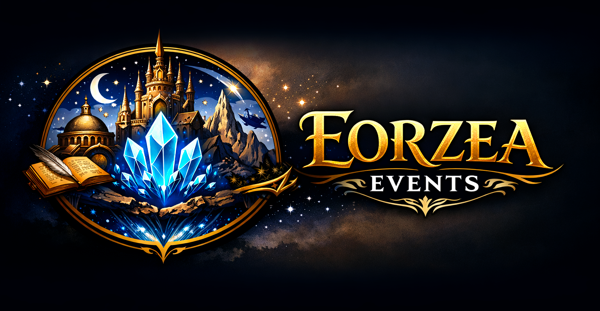
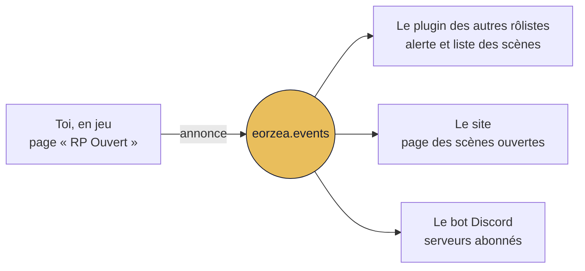

<p align="center">
  
</p>

<p align="center">
  <strong>Le jeu de rôle de Final Fantasy XIV, sans quitter le jeu.</strong><br>
  Les scènes ouvertes, les fiches RP, l'agenda des soirées et l'annuaire des lieux
  d'<a href="https://eorzea.events">eorzea.events</a>, réunis dans une fenêtre Dalamud.
</p>

<p align="center">
  
  
  
  <a href="https://eorzea.events"></a>
</p>

<p align="center"><b>Français</b> · <a href="README.en.md">English</a></p>

---

## Aperçu

<table>
  <tr>
    <td width="50%" valign="top">
      
      <br><sub><b>RP Ouvert</b> · les scènes en cours, regroupées par zone et par monde</sub>
    </td>
    <td width="50%" valign="top">
      
      <br><sub><b>Autour de moi</b> · les rôlistes disponibles, du plus proche au plus lointain</sub>
    </td>
  </tr>
  <tr>
    <td width="50%" valign="top">
      
      <br><sub><b>Fiche RP</b> · consultée en jeu, d'un clic droit sur le personnage</sub>
    </td>
    <td width="50%" valign="top">
      
      <br><sub><b>Plaques de nom</b> · le nom RP, son titre et « Dispo RP » au-dessus des têtes</sub>
    </td>
  </tr>
  <tr>
    <td width="50%" valign="top">
      
      <br><sub><b>Discussion</b> · noms RP, emotes, hors jeu et répliques mis en forme</sub>
    </td>
    <td width="50%" valign="top">
      
      <br><sub><b>Événements</b> · les soirées des deux prochaines semaines</sub>
    </td>
  </tr>
</table>

## Sommaire

- [Installation](#installation)
- [Premiers pas](#premiers-pas)
- [Ce que fait le plugin](#ce-que-fait-le-plugin)
- [Commandes](#commandes)
- [Paramètres](#paramètres)
- [Données et vie privée](#données-et-vie-privée)
- [Aide](#aide)

## Installation

Le plugin se distribue par un dépôt personnalisé de Dalamud.

1. En jeu, tape `/xlsettings` et ouvre l'onglet **Expérimental**.
2. Sous **Dépôts de plugins personnalisés**, colle l'adresse suivante dans le champ vide, clique sur **+**, coche **Activé**, puis enregistre :
   ```
   https://repo.eorzea.events/repo.json
   ```
   Tu avais ajouté l'ancienne adresse, `https://raw.githubusercontent.com/Neprena/eorzea-events-plugin/main/repo.json` ? Garde-la : un plugin installé depuis un dépôt ne reçoit ses mises à jour que de ce dépôt.
3. Tape `/xlplugins`, cherche **Eorzea Events** et installe-le.

## Premiers pas

Au premier lancement, l'écran d'accueil propose deux choix : **lier un personnage** ou **continuer sans compte**.

Pour lier un personnage, connecte-toi dessus, puis clique sur le bouton de liaison : ton navigateur s'ouvre sur une page de confirmation d'eorzea.events. Confirme, et le plugin récupère seul son accès. Aucun jeton à copier.

Chaque personnage a son propre accès. Pour en lier un autre, connecte-toi dessus et tape `/eorzea link`.

> [!TIP]
> Sans compte, l'essentiel reste disponible. Le tableau ci-dessous montre ce qu'un personnage lié ajoute.

| | Sans compte | Personnage lié |
|---|:---:|:---:|
| Agenda des événements, annuaire des lieux | ✓ | ✓ |
| Scènes ouvertes en cours | ✓ | ✓ |
| Fiches publiques des rôlistes croisés | ✓ | ✓ |
| Noms et titres RP sur les plaques, mise en forme du chat | ✓ | ✓ |
| Carnet des rencontres | ✓ | ✓ |
| Ouvrir une scène, te déclarer disponible | | ✓ |
| Ta fiche RP, tes amis RP, tes relations | | ✓ |

## Ce que fait le plugin

La fenêtre principale range ses pages en trois groupes, **Jouer**, **Communauté** et **Agenda**, avec les actualités et les paramètres en bas de la barre latérale.

### Jouer

**RP Ouvert.** Annonce une scène sans quitter le jeu : la zone, le monde et la position se remplissent seuls, tu choisis la durée, et « Prolonger (+1h) » ajoute une heure si la soirée s'étire. Les scènes en cours sont regroupées par zone, par monde et par autres serveurs. Chaque carte indique les coordonnées, l'instance, l'annexe résidentielle et le nombre de personnes sur place. Une scène ne peut pas s'ouvrir à l'adresse d'un établissement déjà enregistré sur le site : le plugin propose alors d'y publier un événement.

Une scène annoncée depuis le jeu apparaît à trois endroits à la fois :



**Autour de moi.** Les rôlistes qui se sont déclarés disponibles, classés par distance : à portée de vue, dans la région, ailleurs dans le monde. « Filtres » restreint la liste à ton monde, à une langue, un niveau de jeu ou une approche.

**Rencontres.** Le carnet des personnages à fiche visible que tu as croisés, avec une note privée pour chacun. Ce carnet reste sur ton PC.

### Communauté

**Mon profil RP.** Jusqu'à trois fiches par personnage, dont une seule publique, celle que tu choisis. Les textes longs s'écrivent dans une fenêtre avec boutons de mise en forme et aperçu. La bannière, le portrait et la couleur d'accent réglés sur le site s'y affichent, ainsi que tes codes de synchronisation (Snowcloak, Umbra…), dont tu choisis qui peut les voir.

**Relations.** Un clic droit sur un rôliste propose « Proposer une relation » : tu choisis le lien parmi neuf types et la personne reçoit une demande. La relation n'apparaît sur ta fiche et sur la sienne qu'une fois acceptée.

**Amis RP.** Les personnages à qui tu ouvres les sections réservées de ta fiche, ajoutés d'un clic droit sans qu'aucune notification ne parte. Un marqueur signale quand l'amitié est réciproque, et chaque ami peut porter une note privée.

### Agenda

**Événements.** Les soirées des quatorze prochains jours, regroupées par jour, avec recherche et filtres. Le détail d'un événement donne sa description entière, ses horaires, sa récurrence en clair, son affiche, l'adresse du lieu et le nombre de personnes inscrites et présentes. Une notification peut te prévenir quand un événement commence.

**Lieux.** L'annuaire des établissements RP, à chercher par nom, serveur ou quartier.

> [!NOTE]
> Avec [Lifestream](https://github.com/NightmareXIV/Lifestream) installé, le bouton « Y aller » d'un événement ou d'un lieu t'y conduit. Sans Lifestream, le bouton n'apparaît pas.

### Actualités

Les actualités du site se lisent dans le plugin, images comprises. L'actualité épinglée s'affiche en haut de la fenêtre principale, et une pastille compte celles parues depuis ta dernière visite. L'équipe peut aussi te transmettre un message d'incident ou de maintenance, même sans personnage lié.

### En jeu, hors de la fenêtre

- **Plaques de nom.** Quand une fiche est publique et le tag « Jeu de rôle » allumé, le nom RP remplace le nom du personnage, dans la couleur de la fiche, et le titre RP remplace le titre. « Dispo RP » s'affiche à la place du titre quand la personne est disponible, et un glyphe précède le nom de tes amis RP. Le ciblage et le clic droit visent toujours le personnage réel.
- **Discussion.** Les noms RP apparaissent dans le chat ; les emotes, le hors jeu et les répliques prennent leurs couleurs. Le message que tu envoies n'est jamais modifié.
- **Infobulle.** En maintenant <kbd>Ctrl</kbd> sur un rôliste disponible, tu vois son nom RP, son état et son coup d'œil sans ouvrir sa fiche. La touche se change, ou se retire, dans les paramètres.
- **Clic droit sur un personnage.** Consulter sa fiche, l'ajouter en ami RP, lui proposer une relation.
- **Barre de statut de Dalamud.** Une entrée montre ta disponibilité et compte les scènes (R) et les événements (E) en cours. Un clic gauche ouvre la fenêtre, un clic droit change ta disponibilité.
- **Réduire à la barre de titre.** La fenêtre principale se replie en une barre, d'où tu changes ta disponibilité.

### Langues

Français, anglais, allemand, italien et espagnol. Le plugin suit la langue du client, et la langue se change dans **Paramètres › Divers › Langue**. En allemand, en italien et en espagnol, les notes de version restent en anglais.

## Commandes

| Commande | Action |
|---|---|
| `/eorzea` | Ouvre la fenêtre principale |
| `/eorzea config` | Ouvre les paramètres |
| `/eorzea link` | Lie le personnage connecté |
| `/eorzea rp <texte>` | Remplace les jetons du texte et copie le résultat |

`/eorzea rp` remplace des jetons par des noms RP, affiche le résultat dans le chat pour que tu le relises, et le copie dans le presse-papiers. Il ne reste qu'à le coller avec <kbd>Ctrl</kbd>+<kbd>V</kbd>. Le plugin n'envoie rien à ta place.

| Jeton | Remplacé par |
|---|---|
| `%xt` | le nom RP de ta cible |
| `%xtf` · `%xtl` | son prénom RP · son nom RP |
| `%xp` | ton nom RP |
| `%xpf` · `%xpl` | ton prénom RP · ton nom RP |

Par exemple, `/eorzea rp *salue %xtf d'un signe de tête*` copie `*salue Elyne d'un signe de tête*` si ta cible s'appelle Elyne Valcourt en RP. Sans nom RP connu, le jeton prend le nom du personnage.

## Paramètres

Les paramètres s'ouvrent par `/eorzea config` ou par l'engrenage du gestionnaire de plugins.

| Onglet | Contenu |
|---|---|
| **Personnages** | Les personnages liés sur ce PC, et ceux de ton compte qui restent à lier. |
| **Discussion** | Couleur des emotes, du hors jeu et des répliques ; noms RP dans le chat ; canaux traités ; jetons de saisie. |
| **Rôleplay** | Disponibilité et partage de position ; noms, couleurs, titres et marqueurs sur les plaques ; carnet des rencontres ; infobulle de survol (touche, contenu) ; alertes des nouvelles scènes (centre de l'écran, bulle Dalamud ou chat, filtres par serveur et par langue). |
| **Notifications** | Événements qui commencent ; alertes de ta propre scène (changement de zone, tag retiré, expiration proche) ; indicateurs de la barre de statut. |
| **Divers** | Opacité et flou des fenêtres, animation du ciel des fiches ; langue ; version et notes de version. |

## Données et vie privée

- **Le carnet des rencontres** reste sur ton PC. Rien n'en est envoyé au site.
- **Ta position** n'est partagée avec les personnes équipées du plugin que si tu actives « Partager ma position quand je suis disponible », et seulement pendant que tu es disponible, tag « Jeu de rôle » allumé. Elle est arrondie, et n'apparaît jamais sur le site.
- **Le comptage des présences** est anonyme : chaque minute en jeu, avec ou sans compte, le plugin transmet la zone, le monde, l'instance, l'adresse résidentielle le cas échéant et la position arrondie, avec un identifiant tiré au hasard à l'installation, sans nom de personnage. C'est ce qui permet d'afficher combien de personnes se trouvent sur une scène ou dans un lieu.
- **Le chat** n'est mis en forme que chez toi. Le plugin ne modifie aucun message que tu envoies, et n'en envoie aucun à ta place.
- **L'accès de chaque personnage** se gère depuis la page « Plugin » de ton espace sur le site.

## Aide

- Le site : [eorzea.events](https://eorzea.events), et la [présentation du plugin](https://eorzea.events/plugin).
- Les notes de version complètes s'ouvrent dans le plugin : **Paramètres › Divers › À propos**.
- Pour un problème ou une question, passe par la [page d'aide](https://eorzea.events/aide) du site.
